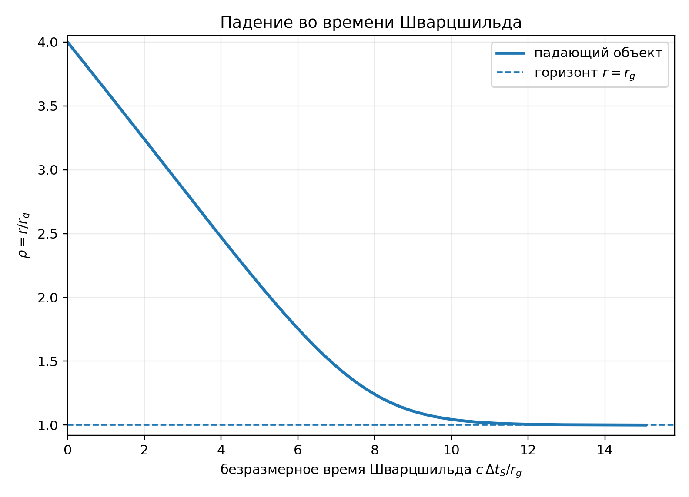
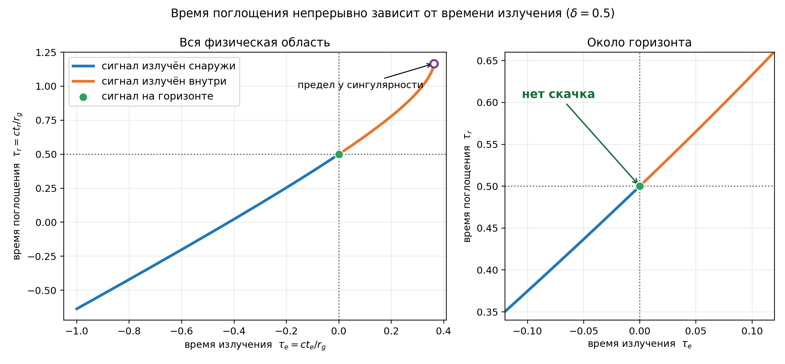
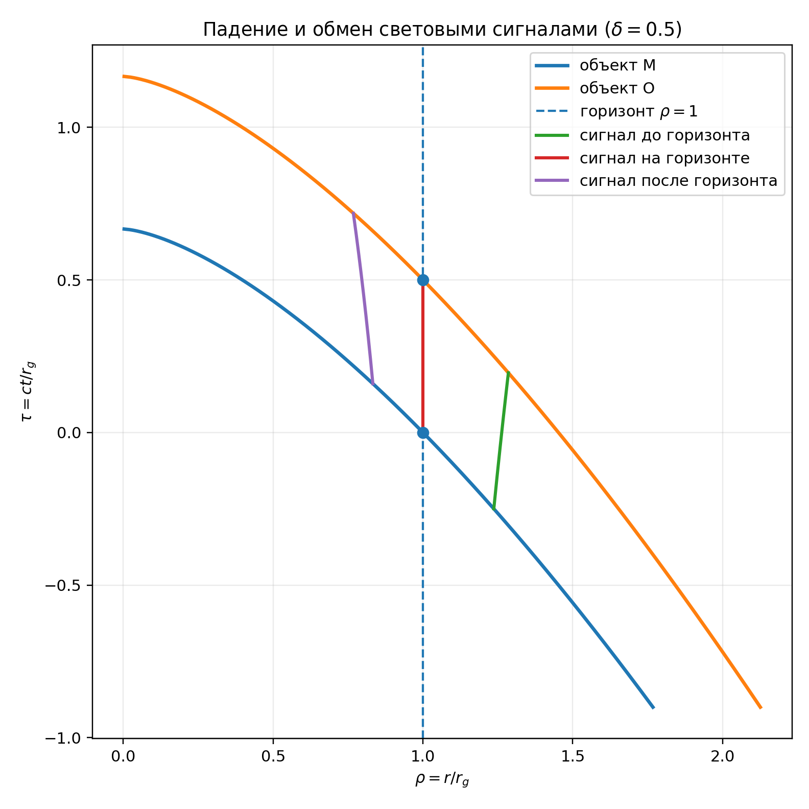

# Задача

## Два падающих объекта и один световой сигнал

:::: {.radial-two-columns}

::: {.radial-card}

Условия

- Чёрная дыра Шварцшильда массы $M_{\rm BH}$.
- Пробные объекты $M$ и $O$ падают из покоя на бесконечности.
- $M$ идёт впереди, $O$ повторяет ту же геодезическую с задержкой $\Delta>0$.
- Обратным влиянием объектов на метрику пренебрегаем.
:::

::: {.radial-card}

Вопрос

Если $M$ излучает наружный радиальный сигнал в момент $t_e$, когда объект $O$ его поглотит?

$$
t_{\rm изл}\quad\longmapsto\quad t_{\rm погл}
$$

Далее кратко: $t_e\equiv t_{\rm изл}$ и $t_r\equiv t_{\rm погл}$.

Что происходит с этой связью при пересечении горизонта?
:::

::::

::: {.takeaway}
Гравитационный радиус: $\displaystyle r_g=\frac{2GM_{\rm BH}}{c^2}$.
:::

## Маршрут решения

::: {.radial-flow}

<strong>1</strong> Увидеть проблему координат Шварцшильда

<strong>2</strong> Перейти ко времени Пенлеве—Гуллстранда

<strong>3</strong> Найти мировые линии и нулевой луч

<strong>4</strong> Связать события излучения и поглощения

:::

$$
\text{метрика}
\;\Longrightarrow\;
r_M(t),\;r_O(t),\;r_\gamma(t)
\;\Longrightarrow\;
t_r(t_e)
$$

::: {.question}
Главное — использовать координаты, которые не ломаются на горизонте.
:::

# Координаты Шварцшильда

## Метрика, горизонт и настоящая сингулярность

:::: {.panel-tabset .radial-tabs}

### Метрика

Для невращающейся сферически-симметричной чёрной дыры

$$
ds^2
=-\left(1-\frac{r_g}{r}\right)c^2dt_S^2
+\frac{dr^2}{1-r_g/r}
+r^2d\Omega^2,
$$

$$
d\Omega^2=d\theta^2+\sin^2\theta\,d\varphi^2.
$$

Радиус $r$ определяет площадь сферы:
$A(r)=4\pi r^2$.

### Радиальная часть

Обозначим

$$
f(r)=1-\frac{r_g}{r}.
$$

Тогда

$$
ds^2=-fc^2dt_S^2+\frac{dr^2}{f}
$$

для радиального движения.

При $r=r_g$ имеем $f=0$: коэффициенты метрики вырождаются.

### Проверка кривизны

Скаляр Кретчмана равен

$$
K=R_{\mu\nu\rho\sigma}R^{\mu\nu\rho\sigma}
=\frac{12r_g^2}{r^6}.
$$

На горизонте

$$
K(r_g)=\frac{12}{r_g^4}<\infty.
$$

Кривизна на горизонте не расходится — это первый признак координатной, а не физической особенности. Ниже мы подтвердим это, построив регулярные координаты. При $r=0$ скаляр $K$ расходится: там находится настоящая сингулярность.

::::

## Радиальный свет во времени Шварцшильда

:::: {.panel-tabset .radial-tabs}

### Нулевое условие

Для радиального света

$$
d\Omega=0,
\qquad ds^2=0.
$$

Поэтому

$$
0=-fc^2dt_S^2+\frac{dr^2}{f}.
$$

### Координатная скорость

Из нулевого условия

$$
\boxed{
\frac{dr}{dt_S}
=\pm cf
=\pm c\left(1-\frac{r_g}{r}\right)
}.
$$

При $r\to r_g^+$ обе координатные скорости стремятся к нулю.

### Интегрирование

Для наружного луча

$$
c\,dt_S=\frac{dr}{1-r_g/r},
$$

откуда

$$
ct_S=r+r_g\ln\left|\frac r{r_g}-1\right|+\text{const}.
$$

Логарифм расходится при $r\to r_g$.

### Почему эти координаты неудобны?

Падающий объект достигает горизонта лишь при

$$
t_S\to+\infty.
$$

А наружному лучу, стартующему всё ближе к горизонту, требуется всё больше времени $t_S$, чтобы дойти до фиксированного внешнего радиуса.

Это не физическая задержка: координата $t_S$ не описывает пересечение будущего горизонта.

::::

## Падение во времени Шварцшильда

::: {.radial-figure .radial-figure-wide}
{fig-alt="Падающая геодезическая во времени Шварцшильда приближается к горизонту лишь при бесконечном координатном времени"}
:::

::: {.radial-caption}
Отсчёт начинается при $r=4r_g$. По мере приближения к горизонту координатное время $t_S$ неограниченно возрастает.
:::

# Свободное падение

## Падение из покоя на бесконечности

:::: {.panel-tabset .radial-tabs}

### Нормировка 4-скорости

Пусть $\tau$ — собственное время частицы. Для радиального движения

$$
-c^2
=-fc^2\left(\frac{dt_S}{d\tau}\right)^2
+\frac1f\left(\frac{dr}{d\tau}\right)^2.
$$

### Сохраняющаяся энергия

Метрика не зависит от $t_S$, поэтому

$$
\varepsilon=f\frac{dt_S}{d\tau}=\text{const}.
$$

Покой на бесконечности даёт

$$
\boxed{\varepsilon=1},
\qquad
\frac{dt_S}{d\tau}=\frac1f.
$$

### Радиальная скорость

Подстановка в нормировку приводит к

$$
\left(\frac{dr}{d\tau}\right)^2
=c^2(1-f)
=c^2\frac{r_g}{r}.
$$

Для падающей частицы

$$
\boxed{
\frac{dr}{d\tau}=-c\sqrt{\frac{r_g}{r}}
}.
$$

### Ньютоновское совпадение

Формально результат совпадает с падением из покоя на бесконечности:

$$
\frac{v^2}{2}-\frac{GM_{\rm BH}}r=0
\quad\Longrightarrow\quad
v=-\sqrt{\frac{2GM_{\rm BH}}r}.
$$

Но в ОТО слева стоит $dr/d\tau$, а не скорость в абсолютном ньютоновском времени.

::::

## Что показывает время Шварцшильда

:::: {.panel-tabset .radial-tabs}

### Координатная скорость

$$
\frac{dr}{dt_S}
=\frac{dr/d\tau}{dt_S/d\tau}
=-cf\sqrt{\frac{r_g}{r}}.
$$

При $r\to r_g^+$ она стремится к нулю, хотя собственное время до горизонта конечно.

### Явная зависимость

Введём

$$
q=\sqrt{\frac r{r_g}}.
$$

Тогда вдоль падающей геодезической

$$
\frac{ct_S}{r_g}
=-\frac23q^3-2q
-\ln\left|\frac{q-1}{q+1}\right|
+\text{const}.
$$

### Вывод

При $q\to1^+$ логарифм даёт

$$
t_S\to+\infty.
$$

Для изучения пересечения горизонта нужна регулярная временная координата.

::::

# Координаты Пенлеве—Гуллстранда

## Строим регулярное время

:::: {.panel-tabset .radial-tabs}

### Замена времени

Сохраним радиус $r$, определяющий площадь сферы, и положим

$$
dt_S=dt-A(r)\,dr.
$$

После подстановки

$$
ds^2=-fc^2dt^2+2fc^2A\,dt\,dr
+\left(\frac1f-fc^2A^2\right)dr^2.
$$

### Выбор функции

Потребуем, чтобы коэффициент при $dr^2$ был равен единице:

$$
\frac1f-fc^2A^2=1.
$$

Для координат, регулярных на будущем горизонте,

$$
A(r)=\frac1c\frac{\sqrt{r_g/r}}{1-r_g/r}.
$$

### Преобразование

Получаем

$$
\boxed{
dt=dt_S+\frac1c\frac{\sqrt{r_g/r}}{1-r_g/r}\,dr
}.
$$

В интегральной форме

$$
ct=ct_S+2\sqrt{rr_g}
+r_g\ln\left|\frac{\sqrt r-\sqrt{r_g}}{\sqrt r+\sqrt{r_g}}\right|
+\text{const}.
$$

### Регулярная метрика

Логарифмические расходимости компенсируются, и

$$
\boxed{
ds^2=-c^2dt^2
+\left(dr+c\sqrt{\frac{r_g}{r}}\,dt\right)^2
+r^2d\Omega^2
}.
$$

Все коэффициенты конечны при $r=r_g$.

::::

## Почему это время удобно именно здесь

:::: {.panel-tabset .radial-tabs}

### Производная времени

Вдоль свободного падения

$$
\frac{dt}{d\tau}
=\frac{dt_S}{d\tau}
+\frac1c\frac{\sqrt{r_g/r}}f\frac{dr}{d\tau}.
$$

### Подстановка

Используем

$$
\frac{dt_S}{d\tau}=\frac1f,
\qquad
\frac{dr}{d\tau}=-c\sqrt{\frac{r_g}{r}}.
$$

Тогда

$$
\frac{dt}{d\tau}
=\frac1f-\frac{r_g/r}{f}=1.
$$

### Физический смысл

Для этой семьи наблюдателей

$$
\boxed{dt=d\tau}.
$$

Вдоль каждой такой геодезической приращение времени Пенлеве—Гуллстранда совпадает с приращением собственного времени. Начала их отсчёта могут различаться.

### Уравнение движения

Поэтому

$$
\boxed{
\frac{dr}{dt}=-c\sqrt{\frac{r_g}{r}}
}.
$$

Теперь одна координата времени описывает движение и снаружи, и внутри горизонта.

::::

# Мировые линии и свет

## Два объекта с временным сдвигом

:::: {.panel-tabset .radial-tabs}

### Интегрирование

Из

$$
\frac{dr}{dt}=-c\sqrt{\frac{r_g}{r}}
$$

следует

$$
r^{1/2}dr=-c\sqrt{r_g}\,dt,
$$

$$
\frac23r^{3/2}=-c\sqrt{r_g}\,t+C.
$$

### Объект $M$

Выберем $t=0$ в момент пересечения горизонта объектом $M$:

$$
\boxed{
r_M(t)=r_g\left(1-\frac{3ct}{2r_g}\right)^{2/3}
}.
$$

Он достигает $r=0$ при $t=2r_g/(3c)$. Формула описывает физическую мировую линию только до этого момента.

### Объект $O$

Второй объект повторяет ту же геодезическую с задержкой $\Delta$:

$$
\boxed{
r_O(t)=r_g\left(1-\frac{3c(t-\Delta)}{2r_g}\right)^{2/3}
}.
$$

Следовательно, $r_O(\Delta)=r_g$. Мировая линия заканчивается при $t=\Delta+2r_g/(3c)$.

### Геометрия задержки

Обе мировые линии имеют одну форму:

$$
r_O(t)=r_M(t-\Delta).
$$

$M$ пересекает горизонт при $t=0$, а $O$ — при $t=\Delta$.

::::

## Радиальные нулевые геодезические

:::: {.panel-tabset .radial-tabs}

### Нулевое условие

Из метрики Пенлеве—Гуллстранда

$$
0=-c^2dt^2
+\left(dr+c\sqrt{\frac{r_g}{r}}\,dt\right)^2.
$$

Значит,

$$
\frac{dr}{dt}+c\sqrt{\frac{r_g}{r}}=\pm c.
$$

### Две ветви

$$
\boxed{
\frac{dr_\gamma}{dt}
=c\left(1-\sqrt{\frac{r_g}{r_\gamma}}\right)
}
\quad\text{наружный луч},
$$

$$
\boxed{
\frac{dr_\gamma}{dt}
=-c\left(1+\sqrt{\frac{r_g}{r_\gamma}}\right)
}
\quad\text{внутренний луч}.
$$

### Наружный луч

Для сигнала от внутреннего $M$ к внешнему $O$ нужна наружная ветвь:

$$
\frac{dr_\gamma}{dt}
\begin{cases}
>0, & r>r_g,\\
=0, & r=r_g,\\
<0, & r<r_g.
\end{cases}
$$

### Внутри горизонта

Свет локально по-прежнему движется со скоростью $c$.

Но $dr/dt$ — скорость изменения радиуса сфер симметрии. Внутри горизонта даже наружная граница будущего светового конуса ведёт к меньшим $r$.

Наружный луч, излучённый снаружи, остаётся снаружи; излучённый внутри — остаётся внутри. Луч, излучённый точно на горизонте, остаётся на нём и разделяет эти два случая.

::::

## Как сигнал догоняет второй объект



::: {.radial-caption}
Переключите три момента излучения. Левая панель показывает радиальные положения «сейчас», правая — полные мировые линии и тот же световой луч.
:::

# Результат до вычислений

## Время поглощения: разрыва нет

::: {.radial-figure .radial-figure-wide .radial-figure-compact}
{fig-alt="График времени поглощения сигнала объектом O в зависимости от времени его излучения объектом M; внешняя и внутренняя ветви непрерывно соединяются на горизонте"}
:::

::: {.radial-caption}
Время измеряется в единицах $r_g/c$; $\delta=c\Delta/r_g=0.5$ — безразмерная задержка между объектами. Кривая построена по точному уравнению, которое мы сейчас выведем.
:::

## Как читать этот график

::: {.radial-flow .radial-flow-three}

<strong>$t_e<0$</strong> Сигнал излучён снаружи и поглощён до пересечения горизонта объектом $O$.

<strong>$t_e=0$</strong> Сигнал идёт по горизонту и поглощается при $t_r=\Delta$.

<strong>$t_e>0$</strong> Пока поглощение возможно, оно происходит уже внутри горизонта.

:::

::: {.takeaway}
Синяя и оранжевая ветви сходятся в одной точке: при переходе через горизонт скачка времени поглощения нет.
:::

## Это не выход света наружу

:::: {.radial-two-columns}

::: {.radial-card}

Что здесь происходит

Объект $O$ тоже падает в чёрную дыру. После горизонта он всё ещё может пересечь наружный световой луч, излучённый объектом $M$.
:::

::: {.radial-card}

Чего здесь не происходит

Свет изнутри не выходит к далёкому внешнему наблюдателю. И объект, и сигнал внутри горизонта движутся к меньшим $r$.
:::

::::

# Точное решение

## Интегрируем наружный световой луч

:::: {.panel-tabset .radial-tabs}

### Новая переменная

Введём

$$
q=\sqrt{\frac r{r_g}},
\qquad r=r_gq^2,
\qquad dr=2r_gq\,dq.
$$

Для наружного луча

$$
\frac{dr}{dt}=c\frac{q-1}{q}.
$$

### Разделяем переменные

$$
c\,dt
=\frac{q}{q-1}\,dr
=\frac{2r_gq^2}{q-1}\,dq.
$$

Используем

$$
\frac{q^2}{q-1}=q+1+\frac1{q-1}.
$$

### Интеграл

$$
ct
=r_g\left[q^2+2q+2\ln|q-1|\right]
+\text{const}.
$$

Определим

$$
F(q)=q^2+2q+2\ln|q-1|.
$$

### Постоянная вдоль луча

Вдоль каждой наружной радиальной нулевой геодезической

$$
\boxed{ct-r_gF(q)=\text{const}}.
$$

Уравнение применимо отдельно снаружи ($q>1$) и внутри ($0<q<1$). При $q=1$ функция $F$ расходится, поэтому луч на горизонте нужно рассмотреть отдельно.

::::

## От излучения к поглощению

:::: {.panel-tabset .radial-tabs}

### Два события

При излучении и поглощении

$$
q_e=\sqrt{\frac{r_M(t_e)}{r_g}},
\qquad
q_r=\sqrt{\frac{r_O(t_r)}{r_g}}.
$$

### Один и тот же луч

Оба события лежат на одном световом луче, поэтому постоянная одинакова:

$$
ct_r-r_gF(q_r)
=ct_e-r_gF(q_e).
$$

### Точное условие

Следовательно,

$$
\boxed{
\frac{c(t_r-t_e)}{r_g}
=F(q_r)-F(q_e)
}.
$$

Осталось выразить $q_e$ и $q_r$ через мировые линии объектов.

::::

## Точная карта $t_e\mapsto t_r$

:::: {.panel-tabset .radial-tabs}

### Безразмерные времена

Введём

$$
\tau=\frac{ct}{r_g},
\qquad
\delta=\frac{c\Delta}{r_g}.
$$

На мировых линиях

$$
\tau_e=\frac23(1-q_e^3),
\qquad
\tau_r=\delta+\frac23(1-q_r^3).
$$

### Подстановка

Уравнение луча становится

$$
\delta+\frac23(q_e^3-q_r^3)
=F(q_r)-F(q_e).
$$

Перегруппируем члены, зависящие от $q_e$ и $q_r$.

### Функция $H$

Определим

$$
H(q)=\frac23q^3+F(q)
=\frac23q^3+q^2+2q+2\ln|q-1|.
$$

Тогда

$$
\boxed{H(q_r)-H(q_e)=\delta}.
$$

### Алгоритм

Для заданного $t_e$:

1. вычислить $q_e$ по мировой линии $M$;
2. решить $H(q_r)=H(q_e)+\delta$;
3. найти $\displaystyle \tau_r=\delta+\frac23(1-q_r^3)$.

### Однозначность

$$
H'(q)=\frac{2q^3}{q-1}.
$$

$H$ возрастает при $q>1$ и убывает при $0<q<1$.

Снаружи $q_r>q_e>1$, а внутри $0<q_r<q_e<1$. На каждой ветви решение единственно, пока объект $O$ не достиг сингулярности.

Точка $q_e=q_r=1$ в это уравнение не подставляется: её мы рассматриваем отдельно.

::::

# Горизонт

## Сигнал, излучённый непосредственно на горизонте

:::: {.panel-tabset .radial-tabs}

### Событие излучения

Пусть

$$
t_e=0.
$$

По выбору начала времени

$$
r_M(0)=r_g.
$$

### Уравнение луча

На горизонте наружная ветвь даёт

$$
\left.\frac{dr_\gamma}{dt}\right|_{r=r_g}
=c(1-1)=0.
$$

### Луч остаётся на горизонте

Поэтому

$$
\boxed{r_\gamma(t)=r_g}
$$

— точное решение нулевого уравнения: радиус луча не меняется, поэтому луч всё время остаётся на горизонте.

Сам горизонт образован такими световыми лучами. В ОТО их называют **нулевыми образующими**, или **генераторами горизонта**.

### Встреча с $O$

Сигнал встречает $O$, когда

$$
r_O(t_r)=r_g.
$$

Но по определению задержки $r_O(\Delta)=r_g$. Следовательно,

$$
\boxed{t_e=0\quad\Longrightarrow\quad t_r=\Delta}.
$$

::::

## Непрерывность в окрестности горизонта

:::: {.panel-tabset .radial-tabs}

### Разложение $H$

Положим

$$
q=1+s,
\qquad |s|\ll1.
$$

Тогда

$$
H(1+s)=2\ln|s|+\frac{11}{3}+O(s).
$$

### Связь двух событий

Из $H(q_r)-H(q_e)=\delta$ следует

$$
2\ln\left|\frac{s_r}{s_e}\right|\simeq\delta,
$$

$$
\boxed{\frac{|s_r|}{|s_e|}\simeq e^{\delta/2}}.
$$

### Переход ко времени

Для падающей частицы

$$
\tau=\frac23(1-q^3)
=-2s+O(s^2).
$$

Поэтому

$$
\tau_e\simeq-2s_e,
\qquad
\tau_r-\delta\simeq-2s_r.
$$

### Локальная карта

На каждой стороне горизонта знаки $s_e$ и $s_r$ совпадают:

$$
\boxed{
\tau_r-\delta\simeq e^{\delta/2}\tau_e
}.
$$

Значит, $\tau_e\to0^\pm$ влечёт $\tau_r\to\delta^\pm$: разрыва нет.

::::

# Картина целиком

## Мировые линии и три световых сигнала

::: {.radial-figure}
{fig-alt="Мировые линии двух падающих объектов и световые сигналы до, на и после горизонта"}
:::

::: {.radial-caption}
$\delta=0.5$. Сигнал при $\tau_e=0$ лежит на $\rho=1$; сигналы до и после горизонта встречают ту же запаздывающую мировую линию $O$.
:::

## Граница обмена сигналами

:::: {.panel-tabset .radial-tabs}

### Конец мировой линии

Объект $O$ достигает $r=0$ при

$$
\tau_r^{\rm sing}=\delta+\frac23.
$$

После этого события поглощать сигнал уже некому.

### Предельное событие

Для последовательности всё более поздних поглощённых сигналов

$$
q_r\to0^+.
$$

Сам предел лежит уже при $r=0$ и не является обычным событием поглощения.

Поскольку $H(0)=0$, точное уравнение даёт

$$
H(q_e^*)=-\delta.
$$

### Числа для $\delta=0.5$

$$
q_e^*\simeq0.7694707,
$$

$$
\tau_e^*=\frac23(1-q_e^{*3})\simeq0.3629385,
$$

$$
\tau_r\uparrow0.5+\frac23\simeq1.1666667.
$$

### Смысл ограничения

Горизонт сам по себе не создаёт разрыва в обмене сигналами.

Ограничение появляется позже: обе времеподобные мировые линии заканчиваются на физической сингулярности $r=0$.

::::

# Итог

## Что мы получили

::: {.radial-flow}

$r_M(t)$ передний объект

$r_O(t)=r_M(t-\Delta)$ запаздывающий объект

$ct-r_gF(q)=\mathrm{const}$ наружный световой луч

$H(q_r)-H(q_e)=\delta$ точная карта событий

:::

$$
\boxed{t_e=0\quad\Longrightarrow\quad t_r=\Delta}
$$

::: {.takeaway}
Сигналы, излучённые чуть раньше горизонта, поглощаются чуть раньше; излучённые чуть позже — чуть позже. Временного разрыва на горизонте нет.
:::

# Литература

## Основные источники

::: {.small}
1. P. Painlevé, *La mécanique classique et la théorie de la relativité*, C. R. Acad. Sci. (Paris) **173**, 677–680 (1921).

2. A. Gullstrand, *Allgemeine Lösung des statischen Einkörperproblems in der Einsteinschen Gravitationstheorie*, Arkiv. Mat. Astron. Fys. **16** (8), 1–15 (1922).

3. K. Martel, E. Poisson, *Regular coordinate systems for Schwarzschild and other spherical spacetimes*, American Journal of Physics **69**, 476–480 (2001), [arXiv:gr-qc/0001069](https://arxiv.org/abs/gr-qc/0001069).
:::
